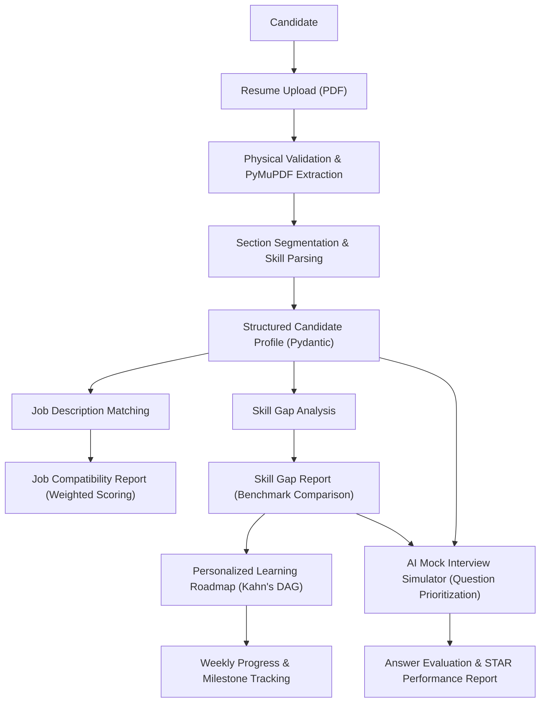
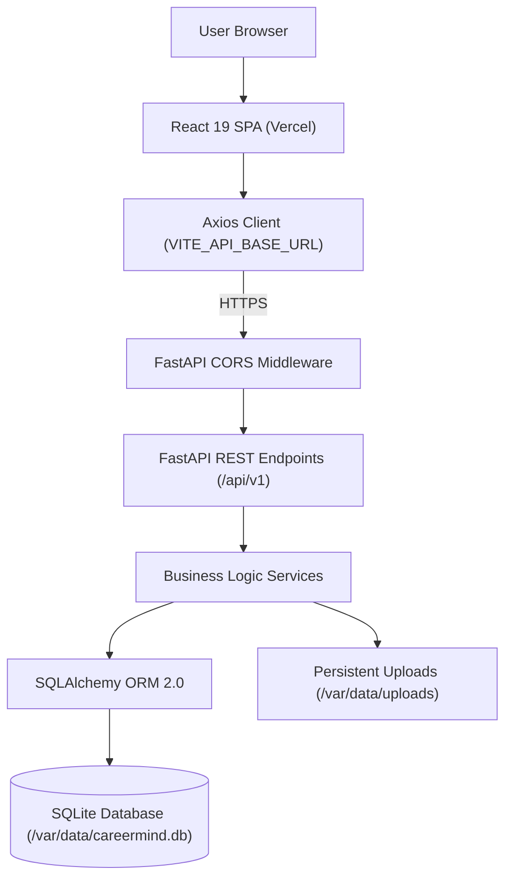

# CareerMind AI 🚀
### Next-Generation AI Career Intelligence & Job Readiness Platform

**Analyze your resume. Discover career opportunities. Identify skill gaps. Build your learning roadmap. Prepare for interviews.**

[](https://www.python.org/)
[](https://fastapi.tiangolo.com/)
[](https://react.dev/)
[](https://vitejs.dev/)
[](https://tailwindcss.com/)
[](https://alembic.sqlalchemy.org/)
[](LICENSE)

---

## 📌 Table of Contents

1. [Project Overview](#-project-overview)
2. [Problem Statement](#-problem-statement)
3. [Five Implemented Capabilities](#-five-implemented-capabilities)
   - [1. Resume Intelligence](#1-resume-intelligence)
   - [2. Job Description Matching](#2-job-description-matching)
   - [3. Skill Gap Analysis](#3-skill-gap-analysis)
   - [4. Personalized Learning Roadmap](#4-personalized-learning-roadmap)
   - [5. AI Mock Interview Simulator](#5-ai-mock-interview-simulator)
4. [Application Workflow](#-application-workflow)
5. [System Architecture](#-system-architecture)
6. [Technology Stack](#-technology-stack)
7. [Database Architecture & Migrations](#-database-architecture--migrations)
8. [API Overview](#-api-overview)
9. [Project Directory Structure](#-project-directory-structure)
10. [Production Deployment Architecture](#-production-deployment-architecture)
    - [Environment Variables](#environment-variables)
    - [Part 1: Render Backend Deployment](#part-1-render-backend-deployment)
    - [Part 2: Vercel Frontend Deployment](#part-2-vercel-frontend-deployment)
    - [Initial Data & PDF Migration](#initial-data--pdf-migration-preserving-local-data)
    - [Production Health Checks](#production-health-checks)
11. [Local Development Setup](#-local-development-setup)
12. [Testing & Quality Assurance](#-testing--quality-assurance)
13. [Current Limitations & Known Hosting Behavior](#-current-limitations--known-hosting-behavior)
14. [Future Enhancements](#-future-enhancements)
15. [License](#-license)

---

## 🎯 Project Overview

**CareerMind AI** is an integrated career intelligence platform designed to help students, fresh graduates, and job seekers prepare for target industry roles. The platform bridges the gap between a candidate's current qualifications and industry requirements through evidence-based resume extraction, multi-dimensional job matching, deterministic skill gap analysis, personalized weekly learning curriculums, and structured mock interview simulations.

- **Project Type:** Full-Stack Web Application
- **Architecture:** React 19 Frontend (SPA) + FastAPI Backend + Persistent SQLite Database
- **Development Approach:** Modular, service-oriented architecture with full separation of concerns
- **Intelligence Methodology:** Rule-based NLP, taxonomy-based skill clustering, TF-IDF lexical relevance, topological roadmap scheduling, and rubric-based interview evaluation.

---

## ❗ Problem Statement

Job seekers face critical hurdles during career preparation:
- **Blind Submissions:** They cannot objectively measure how well their resume aligns with complex job descriptions.
- **Ambiguous Gaps:** They struggle to pinpoint missing core requirements vs. preferred qualifications for their dream roles.
- **Lack of Structure:** They lack actionable, prioritized learning paths tailored to their available weekly study time.
- **Interview Anxiety:** They have few opportunities to practice domain-specific and behavioral questions with immediate, explainable feedback.

CareerMind AI unifies all five preparation stages into an end-to-end, privacy-respecting career workspace.

---

## ✨ Five Implemented Capabilities

All five core features are fully implemented, persistent, and verified with automated test suites.

### 1. Resume Intelligence
<sub>Resume Analysis, Information Extraction & Structured Profiling</sub>

Upload a PDF resume to automatically extract structured candidate data without relying on external cloud LLM APIs.

**Core Capabilities:**
- Secure PDF resume upload and physical validation (file headers, size constraints, MIME type).
- Deterministic text extraction using PyMuPDF (`fitz`).
- Section segmentation identifying Contact, Summary, Skills, Education, Experience, Projects, and Certifications.
- Multi-category technical skill extraction across 10 technical domains.
- Structured profile generation matching Pydantic validation schemas.
- Persistent resume library supporting multiple uploaded resumes, default resume selection, replacement, and safe deletion.

**Technologies:** Python, FastAPI, PyMuPDF, Regex, Pydantic v2, SQLAlchemy.

---

### 2. Job Description Matching
<sub>Multi-Dimensional Resume-to-Job Compatibility Scoring</sub>

Compare candidate profile evidence directly against target job descriptions to identify readiness and missing competencies.

**Core Capabilities:**
- Dynamic parsing of job descriptions into required skills, preferred skills, experience tenure, and education credentials.
- Exact and canonical alias matching across technical skill taxonomies.
- Related skill matching crediting semantically clustered competencies.
- Deterministic lexical relevance calculation using TF-IDF and Cosine Similarity.
- Actionable, prioritized recommendations for addressing requirements.

**Deterministic Scoring Formula:**

| Dimension | Weight | Description |
|---|---:|---|
| **Required Skills** | 40% | Direct coverage of mandatory role technical requirements |
| **Experience Tenure** | 25% | Candidate years of experience vs. job tenure expectation |
| **Preferred Skills** | 15% | Coverage of nice-to-have technologies and tools |
| **Education Level** | 10% | Minimum degree and field alignment |
| **Lexical Relevance** | 10% | Domain vocabulary similarity via TF-IDF |

*Note: If specific dimensions (such as education) are omitted from a job description, unavailable weights are excluded and remaining components are mathematically renormalized.*

**Technologies:** Python, FastAPI, Scikit-learn TF-IDF, Cosine Similarity, React 19.

---

### 3. Skill Gap Analysis
<sub>Role-Based Industry Benchmark Assessment</sub>

Evaluates candidate skills against curated industry benchmarks for 8 popular technology roles.

**Supported Roles:**
- Software Development Engineer (SDE)
- Frontend Developer
- Backend Developer
- Full Stack Developer
- Data Analyst
- Data Scientist
- Machine Learning Engineer
- Python Developer

**Confidence Matching Framework:**

| Match Type | Confidence Score | Weight Applied |
|---|---:|---|
| **Exact Match** | 1.0 | 100% credit for direct skill matches |
| **Alias Match** | 1.0 | 100% credit for recognized synonyms (e.g. Postgres → PostgreSQL) |
| **Related Match** | 0.6 | 60% partial credit for adjacent skills in same domain cluster |
| **Missing** | 0.0 | Skill gap identified for targeted learning |

*Required skills carry a weight multiplier of 1.0; preferred skills carry a multiplier of 0.5.*

**Technologies:** Python, FastAPI, SQLAlchemy, SQLite, React 19.

---

### 4. Personalized Learning Roadmap
<sub>Prerequisite-Aware Curriculum Generation & Weekly Scheduling</sub>

Converts assessed skill gaps into actionable, week-by-week learning curriculums with progress tracking.

**Core Capabilities:**
- Automatic generation derived directly from saved Skill Gap Analysis reports.
- Graph-based dependency resolution using Kahn's algorithm (Directed Acyclic Graphs) for prerequisite ordering.
- Priority classification: `HIGH` (missing required), `MEDIUM` (missing preferred), and `LOW` (related reinforcement).
- Configurable study commitment: Casual (5h/wk), Recommended (10h/wk), Accelerated (15h/wk), or Intensive (20h/wk).
- Multi-week timeline with topic-level checklists, curated free documentation resources, and milestone completion tracking.
- Client-side pagination for timelines and skill modules for seamless mobile navigation.

**Technologies:** Python, FastAPI, NetworkX concepts, SQLAlchemy, SQLite, React 19, Lucide Icons.

---

### 5. AI Mock Interview Simulator
<sub>Deterministic Text-Based Mock Interview Engine & Structured Rubrics</sub>

Conducts realistic technical, behavioral, and project-based interview practice sessions with instant rubric evaluations.

**Interview Formats:**
- **Technical**: Role-specific engineering, data structures, algorithms, and system design questions.
- **Behavioral**: Evaluated using the structured **STAR** framework (Situation, Task, Action, Result).
- **Project-Based**: Architecture, decision tradeoffs, and debugging questions.
- **Mixed**: Comprehensive multi-category interview simulations.

**Question Pool & Categorization:**
Curated across 15 technical and non-technical domains including Programming Fundamentals, Python, JavaScript, React, Node.js, SQL & DBMS, DSA, Operating Systems, Computer Networks, Machine Learning, Deep Learning, Data Analytics, System Design, Projects, and HR/Behavioral.

**Deterministic Answer Evaluation Formula:**
\[
\text{Overall Score} = (0.40 \times \text{Concept Coverage}) + (0.25 \times \text{Relevance}) + (0.20 \times \text{Completeness}) + (0.15 \times \text{Structure})
\]

**Technologies:** Python, FastAPI, Pydantic, SQLAlchemy, SQLite, React 19, Recharts.

---

## 🔄 Application Workflow



---

## 🏗️ System Architecture



---

## 🛠️ Technology Stack

| Layer | Technology | Version | Purpose |
| :--- | :--- | :--- | :--- |
| **Frontend Framework** | React | 19.3.1 | Core user interface and declarative component hierarchy |
| **Build Tooling** | Vite | 8.3.6 | Fast HMR dev server and optimized production bundler |
| **Styling** | Tailwind CSS | 4.3.4 | Utility-first responsive CSS styling with dark/light themes |
| **Routing** | React Router | 7.18.5 | Client-side SPA routing with protected layout guards |
| **HTTP Client** | Axios | 1.21.0 | Asynchronous API communication with response interceptors |
| **Data Visualization**| Recharts | 3.10.1 | Visual match breakdowns, category bars, and radars |
| **Icons & Motion** | Lucide React / Framer | 1.70 / 14.10 | Modern icon set and smooth component transitions |
| **Backend Framework** | FastAPI | 0.162.0 | High-performance ASGI Python web framework |
| **ASGI Server** | Uvicorn | 0.54.0 | Lightning-fast asynchronous server implementation |
| **Document Parsing** | PyMuPDF (`fitz`) | 2.1 | Fast PDF text and font extraction |
| **Data Validation** | Pydantic v2 | 2.14.3 | Strict request/response schema modeling and parsing |
| **ORM** | SQLAlchemy | 2.1.8 | Type-safe database persistence with SQLite WAL support |
| **Migrations** | Alembic | 1.20.1 | Declarative schema revision control |
| **Testing** | pytest | 9.2.0 | Comprehensive unit and integration test runner |

---

## 🗄️ Database Architecture & Migrations

The database is built on SQLite with `PRAGMA foreign_keys=ON` and centralized session lifecycle management.

**Database File:**
- Local: `CareerMind-AI/backend/careermind.db`
- Production (Render): `/var/data/careermind.db`

### Core Entity Schema
- **Candidate & Resume**: `CareerProfile`, `CareerGoal`, `LearningPreference`, `ResumeRecord`, `ResumeProfile`, `ResumeSkill`, `ResumeEducation`, `ResumeExperience`, `ResumeProject`, `ResumeCertification`.
- **Skill Gap Reports**: `SkillGapReport` (stores candidate gap analysis, missing/matched skills, scores, and timestamp).
- **Learning Curriculums**: `LearningRoadmap`, `RoadmapSkill`, `RoadmapTopic`, `LearningResource`, `RoadmapMilestone`.
- **Interview Simulator**: `InterviewSession`, `InterviewSessionQuestion`, `InterviewAnswer`, `InterviewEvaluation`, `InterviewReport`.

### Alembic Migration State
All schema revisions are versioned in `backend/alembic/versions`:
1. `a15558c0f59e`: Career profile, onboarding, and resume library tables.
2. `633bb4235e1e`: Default resume index optimizations.
3. `fbd615962846`: Skill gap reports table and indexes.
4. `b8963813309f`: Learning roadmaps, topics, and milestones tables.
5. `ee34607e5025` *(HEAD)*: Interview simulator sessions, questions, answers, and reports.

---

## 🔌 API Overview

All API endpoints are versioned under `/api/v1`:

| Domain | Method | Endpoint | Description |
| :--- | :---: | :--- | :--- |
| **Core & Health** | `GET` | `/` | Root service ping (database-independent) |
| **Core & Health** | `GET` | `/health` | Production health check (database-independent) |
| **Onboarding** | `GET` | `/onboarding/profile` | Retrieve active local candidate career profile |
| **Onboarding** | `POST`| `/onboarding/profile` | Register or update candidate profile preferences |
| **Resume** | `POST`| `/resumes/upload` | Upload and validate candidate resume PDF |
| **Resume** | `POST`| `/resumes/{file_id}/extract`| Extract raw structured text from uploaded PDF |
| **Resume** | `POST`| `/resumes/{file_id}/parse` | Parse full candidate profile into SQLite |
| **Resume** | `GET` | `/resumes/library` | List all saved resumes with default status |
| **Resume** | `PUT` | `/resumes/library/{id}/default` | Set active default resume for matching |
| **Resume** | `DELETE`| `/resumes/library/{id}` | Safely delete resume record and physical PDF |
| **Job Matching** | `POST`| `/jobs/match` | Perform 5-dimension job compatibility match |
| **Skill Gap** | `GET` | `/skills/roles` | List available industry benchmark roles |
| **Skill Gap** | `POST`| `/skills/analyze` | Execute role-based skill gap assessment |
| **Skill Gap** | `GET` | `/skills/reports` | Retrieve candidate skill gap report history |
| **Skill Gap** | `DELETE`| `/skills/reports/{id}` | Delete specific skill gap report |
| **Learning** | `POST`| `/learning/roadmaps/generate` | Generate Kahn's DAG learning curriculum |
| **Learning** | `GET` | `/learning/roadmaps` | List generated learning roadmaps |
| **Learning** | `PATCH`| `/learning/roadmaps/{id}/topics/{tid}` | Toggle completion status of roadmap topic |
| **Interview** | `GET` | `/interviews/metadata` | Roles, formats, difficulties, question counts |
| **Interview** | `POST`| `/interviews/sessions` | Create interview practice session |
| **Interview** | `GET` | `/interviews/sessions/{id}/current-question` | Get active question without answer leaks |
| **Interview** | `POST`| `/interviews/sessions/{id}/answer` | Submit text answer and trigger rubric grading |
| **Interview** | `POST`| `/interviews/sessions/{id}/complete` | Finalize session and generate report |
| **Interview** | `GET` | `/interviews/sessions/{id}/report` | Retrieve comprehensive evaluation report |
| **Dashboard** | `GET` | `/dashboard/insights` | Aggregate real candidate profile metrics |

---

## 📁 Project Directory Structure

```text
CareerAI/
├── render.yaml                   # Root Render Blueprint specification
├── .gitignore                    # Root Git exclusion rules
├── README.md                     # Master project documentation
│
└── CareerMind-AI/
    ├── backend/                  # FastAPI high-performance backend application
    │   ├── api/v1/endpoints/     # REST routers: resume, jobs, skills, learning, interviews, dashboard
    │   ├── database/             # SQLAlchemy models, session engine, Base metadata
    │   ├── resume_engine/        # PDF extraction, section segmentation, entity parsing
    │   ├── matching_engine/      # Job description matching, TF-IDF lexical calculator
    │   ├── services/             # Business logic: storage, gap analysis, roadmap, interview catalog
    │   ├── alembic/              # Database migration scripts (Head: ee34607e5025)
    │   ├── tests/unit/           # 267 automated unit and integration tests (100% pass)
    │   ├── main.py               # FastAPI entry point, CORS middleware, health checks
    │   ├── requirements.txt      # Production Python dependencies
    │   ├── careermind.db         # Local SQLite database (persisted, ignored by git)
    │   └── .env.example          # Backend environment variable template
    │
    ├── frontend/                 # React 19 Single Page Application
    │   ├── src/
    │   │   ├── pages/            # Landing, Dashboard, ResumeAnalyzer, JobMatcher, SkillGap, Roadmap, Interview
    │   │   ├── components/       # UI modules, navigation, modals, timeline, charts
    │   │   ├── services/api.js   # Dynamic Axios client with VITE_API_BASE_URL support
    │   │   └── App.jsx           # React Router 7 client routing and layout guards
    │   ├── public/               # Static web assets and icons
    │   ├── vercel.json           # Vercel SPA rewrite specification (/(.*) -> /index.html)
    │   ├── vite.config.js        # Vite build configuration and local API proxy
    │   ├── package.json          # Frontend npm scripts and dependencies
    │   └── .env.example          # Frontend environment variable template
    │
    └── data/
        └── uploads/              # Local PDF resume storage directory (ignored by git)
```

---

## ☁️ Production Deployment Architecture

CareerMind AI is designed for zero-downtime, decoupled deployment:

```text
┌─────────────────────────────────────────────────────────────┐
│                    Vercel Frontend (SPA)                    │
│   • Host: Vercel Global Edge Network                        │
│   • Dynamic API client: VITE_API_BASE_URL                   │
│   • vercel.json rewrite enables direct subroute navigation  │
└──────────────────────────────┬──────────────────────────────┘
                               │ HTTPS REST Calls
                               ▼
┌─────────────────────────────────────────────────────────────┐
│                 Render Web Service (Backend)                │
│   • Host: Render Cloud (Python 3.11.9)                      │
│   • ASGI Server: Uvicorn on 0.0.0.0:$PORT                   │
│   • Whitelisted CORS Middleware for Vercel origin           │
│   • Non-blocking /health and / endpoints                    │
└──────────────────────────────┬──────────────────────────────┘
                               │ Mounts /var/data
                               ▼
┌─────────────────────────────────────────────────────────────┐
│            Render Persistent Disk (/var/data, 1GB)          │
│   • SQLite Database:      /var/data/careermind.db           │
│   • Persistent Resumes:   /var/data/uploads/*.pdf           │
└─────────────────────────────────────────────────────────────┘
```

### Environment Variables

#### Render Backend Configuration
| Variable | Value for Production | Description |
| :--- | :--- | :--- |
| `DATABASE_URL` | `sqlite:////var/data/careermind.db` | Mounts database to persistent disk (auto-creates folder) |
| `CAREERMIND_UPLOAD_DIR` | `/var/data/uploads` | Stores uploaded resumes persistently across redeploys |
| `FRONTEND_ORIGINS` | `http://localhost:5173,https://<YOUR-APP>.vercel.app` | Whitelists frontend domain for credentials/CORS |
| `PYTHON_VERSION` | `3.11.9` | Locks Python version on Render Linux runtime |

#### Vercel Frontend Configuration
| Variable | Value for Production | Description |
| :--- | :--- | :--- |
| `VITE_API_BASE_URL` | `https://<YOUR-RENDER-SERVICE>.onrender.com/api/v1` | Instructs Axios to communicate with Render backend |

---

### Part 1: Render Backend Deployment

1. **Create Web Service**:
   - In [Render Dashboard](https://dashboard.render.com/), click **New +** -> **Web Service**.
   - Connect your GitHub repository (`CareerMind---AI`).
2. **Configure Settings**:
   - **Name**: `careermind-ai-backend`
   - **Root Directory**: `CareerMind-AI/backend`
   - **Runtime**: `Python 3`
   - **Build Command**: `pip install -r requirements.txt`
   - **Start Command**: `uvicorn main:app --host 0.0.0.0 --port $PORT`
   - **Health Check Path**: `/health`
3. **Attach Persistent Disk**:
   - In the **Disks** tab, click **Add Disk**.
   - **Name**: `careermind-data`
   - **Mount Path**: `/var/data`
   - **Size**: `1 GB`
4. **Add Environment Variables**:
   - `DATABASE_URL`: `sqlite:////var/data/careermind.db`
   - `CAREERMIND_UPLOAD_DIR`: `/var/data/uploads`
   - `FRONTEND_ORIGINS`: `http://localhost:5173,https://YOUR-FRONTEND.vercel.app`
   - `PYTHON_VERSION`: `3.11.9`
5. Click **Create Web Service**.

---

### Part 2: Vercel Frontend Deployment

1. **Import Project**:
   - In [Vercel Dashboard](https://vercel.com/), click **Add New...** -> **Project**.
   - Connect your GitHub repository.
2. **Configure Settings**:
   - **Root Directory**: Click Edit and select `CareerMind-AI/frontend`.
   - **Framework Preset**: `Vite`
   - **Build Command**: `npm run build`
   - **Output Directory**: `dist`
3. **Environment Variables**:
   - Add `VITE_API_BASE_URL`: `https://<YOUR-RENDER-BACKEND>.onrender.com/api/v1`
4. **Deploy**:
   - Click **Deploy**. Vercel will read [`vercel.json`](file:///C:/Users/ASUS/Videos/CareerAI/CareerMind-AI/frontend/vercel.json) to handle SPA routing.
   - Once assigned a live domain (e.g., `https://careermind-ai.vercel.app`), add that domain into the `FRONTEND_ORIGINS` variable on Render.

---

### Initial Data & PDF Migration (Preserving Local Data)

Because Render persistent disks start empty, choose one of two options:

- **Option A (Fresh Database)**:
  Open the Render **Shell** tab and run:
  ```bash
  alembic upgrade head
  ```
  This creates the complete schema through revision `ee34607e5025`.

- **Option B (Migrating Existing Candidate Profile & Uploaded PDFs)**:
  Enable SSH in Render Service settings, then transfer local data:
  ```bash
  # 1. Copy local SQLite database to persistent disk
  scp -P <RENDER_PORT> CareerMind-AI/backend/careermind.db <USER>@<HOST>:/var/data/careermind.db

  # 2. Copy local resume PDFs to persistent uploads directory
  scp -P <RENDER_PORT> -r CareerMind-AI/data/uploads/* <USER>@<HOST>:/var/data/uploads/
  ```

---

### Production Health Checks

Verify your deployment status without initiating database queries:

```bash
# 1. Root Ping
curl -i https://YOUR-BACKEND.onrender.com/
# HTTP 200 {"message": "Welcome to CareerMind AI", "status": "running"}

# 2. Health Endpoint
curl -i https://YOUR-BACKEND.onrender.com/health
# HTTP 200 {"status": "healthy", "application": "CareerMind AI"}
```

---

## 🛠️ Local Development Setup

### 1. Prerequisites
- Python 3.11+ (verified up to Python 3.14)
- Node.js 18+ and npm
- Git

### 2. Backend Setup
```bash
cd CareerMind-AI/backend

# Create and activate virtual environment
python -m venv .venv
source .venv/bin/activate       # On Linux/macOS
.\.venv\Scripts\Activate.ps1    # On Windows PowerShell

# Install dependencies
pip install -r requirements.txt

# Run migrations (creates local careermind.db)
alembic upgrade head

# Start FastAPI development server
uvicorn main:app --reload --host 127.0.0.1 --port 8000
```
API Documentation: `http://127.0.0.1:8000/docs`

### 3. Frontend Setup
```bash
cd CareerMind-AI/frontend

# Install dependencies
npm install

# Start Vite dev server with proxy to backend
npm run dev
```
Client URL: `http://localhost:5173`

---

## 🧪 Testing & Quality Assurance

### Automated Backend Tests
From `CareerMind-AI/backend`:
```bash
pytest tests/unit
```
**Current Test Coverage**: **267 passed, 0 failed, 100% pass rate in ~7 seconds**.
Includes unit tests for candidate parsing, roundtrip fidelity, job matching, skill gap classification, roadmap generation, interview simulations, and deployment CORS/storage verification.

### Frontend Quality Checks
From `CareerMind-AI/frontend`:
```bash
# ESLint code quality
npm run lint

# Production Vite build
npm run build
```
Build output produces an optimized, code-split `dist/` bundle in < 2 seconds with 0 warnings or errors.

---

## ⚠️ Current Limitations & Known Hosting Behavior

1. **Local-First AI Engine**: The core extraction and evaluations use deterministic rule-based NLP, regex, taxonomy matching, and TF-IDF rather than external cloud LLMs. This delivers 100% privacy, explainability, zero API costs, and low latency.
2. **Render Free Tier Spin-Down**: Free-tier Render Web Services spin down after 15 minutes of inactivity. Initial cold-start requests may experience a 30–50 second delay while the container boots.
3. **SQLite Single-Writer Model**: SQLite with WAL mode is exceptionally fast for single-instance web services, but does not support multi-container horizontal autoscaling.

---

## 🚀 Future Enhancements

- Multi-tenant JWT authentication and user accounts.
- Managed PostgreSQL integration for horizontal cluster scaling.
- S3/Cloudflare R2 object storage for distributed resume hosting.
- Optical Character Recognition (OCR) for scanned image-only PDF resumes.
- Transformer-based semantic embeddings (Bi-Encoders/Cross-Encoders) for deeper lexical similarity.
- Voice-enabled speech-to-text mock interview practice.

---

## 📄 License

This project is licensed under the [MIT License](LICENSE).
All candidate datasets and resume fixtures adhere to privacy anonymization standards.

---

**CareerMind AI — Understand Your Skills. Discover Your Potential. Build Your Future.**
