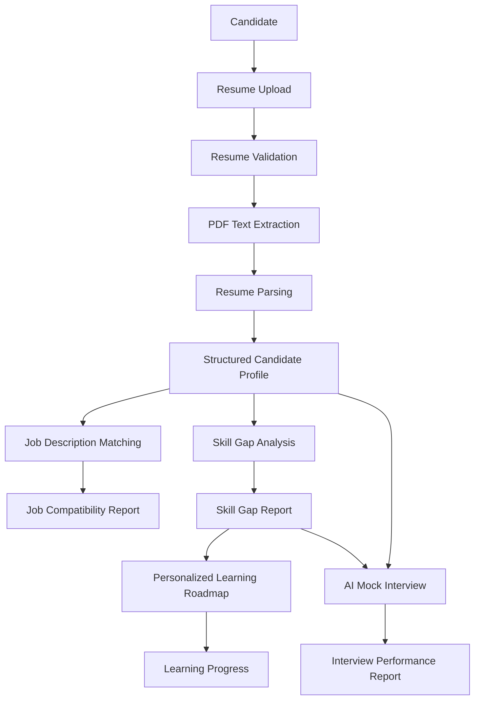
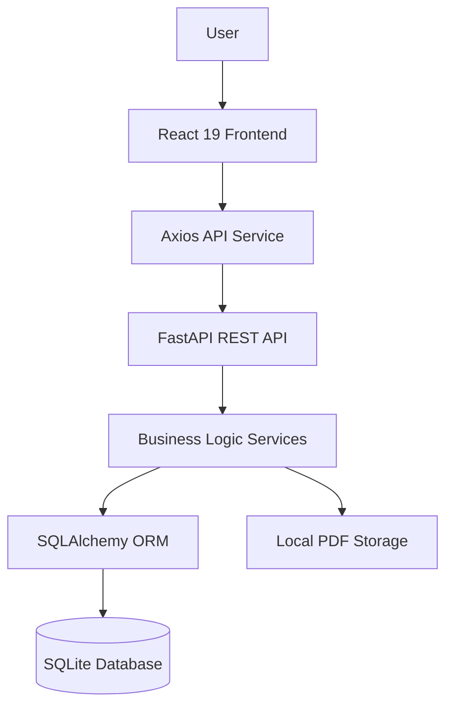

# CareerMind AI 🚀
### AI-Powered Career Intelligence Platform

**Analyze your resume. Discover career opportunities. Identify skill gaps. Build your learning roadmap. Prepare for interviews.**

CareerMind AI is an integrated career intelligence platform designed to help students, fresh graduates and job seekers prepare for their target careers through resume analysis, job matching, skill gap identification, personalized learning roadmaps and mock interview practice.

It brings five essential stages of career preparation together in one platform.

---

## 📌 Table of Contents

1. [Project Overview](#-project-overview)
2. [Problem Statement](#-problem-statement)
3. [Key Features](#-key-features)
4. [Application Workflow](#-application-workflow)
5. [Technology Stack](#-technology-stack)
6. [System Architecture](#-system-architecture)
7. [Feature-Wise Technical Details](#-feature-wise-technical-details)
8. [Database Architecture](#-database-architecture)
9. [API Overview](#-api-overview)
10. [Project Structure](#-project-structure)
11. [Installation and Setup](#-installation-and-setup)
12. [Running the Application](#-running-the-application)
13. [Testing](#-testing)
14. [Current Limitations](#-current-limitations)
15. [Future Enhancements](#-future-enhancements)

---

## 🎯 Project Overview

CareerMind AI helps candidates understand where they stand professionally and what they need to do next to become better prepared for their target roles.

The platform follows an integrated career preparation workflow:

- Analyze candidate resumes.
- Match candidate profiles against job descriptions.
- Identify missing and related skills.
- Generate personalized learning roadmaps.
- Practice interviews and receive structured feedback.

**Project Type:** Full-Stack Web Application

**Architecture:** React Frontend + FastAPI Backend + SQLite Database

**Development Approach:** Modular, service-oriented architecture

**AI Approach:** Rule-based NLP, taxonomy-based matching, algorithmic recommendations and deterministic rubric-based evaluation.

---

## ❗ Problem Statement

Job seekers often face several challenges during career preparation:

- They do not know how well their resumes match job requirements.
- They struggle to identify the skills missing for their target roles.
- They lack a structured learning plan.
- They do not know which topics to prioritize.
- They have limited opportunities to practice interviews and evaluate their answers.

CareerMind AI addresses these challenges through five connected career preparation modules.

---

## ✨ Key Features

All five core features are implemented.

### 1. Resume Intelligence

<sub>Resume Analysis & Candidate Profiling</sub>

Upload a PDF resume and extract structured candidate information.

**Capabilities:**
- PDF resume upload and validation.
- Resume text extraction using PyMuPDF.
- Automated section identification.
- Technical skill extraction.
- Education extraction.
- Work experience extraction.
- Project extraction.
- Certification and achievement extraction.
- Structured candidate profile generation.
- Persistent resume library.
- Default resume selection.
- Resume replacement and deletion.

**Technologies:** Python, FastAPI, PyMuPDF, Regex, Pydantic, SQLAlchemy.

### 2. Job Description Matching

<sub>Resume-to-Job Compatibility Analysis</sub>

Compare a candidate's resume with a job description to identify how closely their profile aligns with the requirements.

**Capabilities:**
- Required and preferred skill extraction.
- Exact skill matching.
- Alias-based skill matching.
- Related skill identification.
- Missing skill identification.
- Experience requirement comparison.
- Education requirement comparison.
- TF-IDF-based lexical relevance.
- Cosine similarity.
- Weighted compatibility scoring.
- Actionable recommendations.

**Scoring Dimensions:**

| Dimension | Weight |
|---|---:|
| Required Skills | 40% |
| Experience | 25% |
| Preferred Skills | 15% |
| Education | 10% |
| Lexical Relevance | 10% |

Unavailable scoring dimensions are excluded and the remaining weights are renormalized.

**Technologies:** Python, FastAPI, Scikit-learn TF-IDF functionality, Cosine Similarity, React.

### 3. Skill Gap Analysis

<sub>Role-Based Skill Assessment</sub>

Identify the difference between a candidate's existing skill evidence and the skills expected for a selected career role.

**Supported Roles:**
- Software Development Engineer
- Frontend Developer
- Backend Developer
- Full Stack Developer
- Data Analyst
- Data Scientist
- Machine Learning Engineer
- Python Developer

**Capabilities:**
- Role-based skill benchmarks.
- Exact and alias skill matching.
- Related skill classification.
- Missing skill identification.
- Required skill coverage.
- Preferred skill coverage.
- Category-wise skill analysis.
- Weighted skill gap scoring.
- Persistent analysis reports.
- Analysis history.

**Matching Confidence:**

| Match Type | Confidence |
|---|---:|
| Exact Match | 1.0 |
| Alias Match | 1.0 |
| Related Match | 0.6 |
| Missing | 0.0 |

Required skills receive a weight of 1.0 and preferred skills receive a weight of 0.5.

**Technologies:** Python, FastAPI, SQLAlchemy, SQLite, React.

### 4. Personalized Learning Roadmap

<sub>Structured Learning & Progress Tracking</sub>

Convert skill gap analysis into an actionable learning plan.

**Capabilities:**
- Roadmap generation from saved Skill Gap Analysis reports.
- Algorithm-based skill prioritization.
- Prerequisite-based learning sequences.
- HIGH, MEDIUM and LOW priority classification.
- Curated free learning resources.
- Weekly learning plans.
- Learning milestones.
- Topic-level progress tracking.
- Skill completion tracking.
- Remaining learning hours.
- Next recommended topic.
- Roadmap history.

**Core Algorithms:**
- Directed dependency graphs.
- Topological sorting.
- Kahn's algorithm.
- Cycle detection.
- Priority-based skill ordering.

**Learning Preferences:**
- Daily learning hours.
- Preferred learning style.
- Weekly study commitment.
- Custom study hours.

**Technologies:** Python, FastAPI, SQLAlchemy, SQLite, React, Recharts.

### 5. AI Mock Interview Simulator

<sub>Text-Based Interview Practice & Evaluation</sub>

Practice structured interviews and receive transparent, rubric-based feedback.

**Interview Types:**
- Technical
- HR / Behavioral
- Project-Based
- Mixed

**Difficulty Levels:**
- Beginner
- Intermediate
- Advanced

**Question Categories:**
- Programming Fundamentals
- Python
- JavaScript
- React
- Node.js
- SQL and DBMS
- Data Structures and Algorithms
- Operating Systems
- Computer Networks
- Machine Learning
- Deep Learning
- Data Analytics
- System Design
- Projects and Practical Experience
- HR and Behavioral

**Capabilities:**
- Role-based interview configuration.
- Curated question bank.
- Skill-gap-based question prioritization.
- One-question-at-a-time interview experience.
- Text-based answer submission.
- Structured answer evaluation.
- Concept coverage analysis.
- Missing concept identification.
- Strengths and improvement suggestions.
- Final performance reports.
- Interview history.

**Evaluation Formula:**

Overall Score:

\[
\begin{aligned}
Score ={}& 0.40 \times ConceptCoverage\\
&+0.25 \times Relevance\\
&+0.20 \times Completeness\\
&+0.15 \times Structure
\end{aligned}
\]

Behavioral questions also use STAR framework recognition:

- Situation
- Task
- Action
- Result

**Important:** The current evaluator is deterministic and rubric-based. It uses lexical and concept matching rather than an external LLM or deep semantic understanding.

**Technologies:** Python, FastAPI, Pydantic, SQLAlchemy, SQLite, React, Recharts.

---

## 🔄 Application Workflow

CareerMind AI connects all five features through shared candidate data and persisted reports.



### Feature Integration

| Feature | Uses |
|---|---|
| Resume Intelligence | PDF extraction and structured profile parsing |
| Job Matching | Saved resume profile and job description |
| Skill Gap Analysis | Parsed candidate skills and role benchmarks |
| Learning Roadmap | Saved Skill Gap Analysis report |
| Mock Interview | Optional resume and Skill Gap Analysis report |

These operations are connected through saved records and shared services. They are not an automatically executing pipeline; candidates initiate the relevant operations.

---

## 🛠️ Technology Stack

### Frontend

| Technology | Purpose |
|---|---|
| React 19 | UI development |
| Vite | Development server and production build |
| Tailwind CSS v4 | Styling and responsive layouts |
| React Router 7 | Client-side routing |
| Axios | API communication |
| Framer Motion | Animations |
| Lucide React | Icons |
| Recharts | Data visualization |

### Backend

| Technology | Purpose |
|---|---|
| Python 3.14 | Backend programming |
| FastAPI | REST API development |
| Pydantic v2 | Data validation and schemas |
| PyMuPDF | PDF text extraction |
| SQLAlchemy | ORM and database operations |
| Alembic | Database migrations |
| pytest | Automated testing |
| HTTPX | API and integration testing |

### Database and Storage

- SQLite
- SQLAlchemy ORM
- Alembic migrations
- Local PDF file storage
- JSON fields for structured report data

### Development Tools

- Git
- GitHub
- VS Code
- Antigravity
- Playwright
- ESLint

---

## 🏗️ System Architecture

CareerMind AI follows a modular frontend-backend architecture.



### Architectural Principles

- Separation of concerns.
- Reusable service modules.
- Centralized database session management.
- Reusable candidate profile infrastructure.
- Version-controlled database migrations.
- Modular feature architecture.
- Backward compatibility with existing APIs.
- Storage abstraction for resume files.

---

## 🗄️ Database Architecture

The application uses SQLite with SQLAlchemy ORM.

**Database file:**

`backend/careermind.db`

### Core Database Models

**Candidate and Resume Management**
- CareerProfile
- CareerGoal
- LearningPreference
- ResumeRecord
- ResumeProfile
- ResumeSkill
- ResumeEducation
- ResumeExperience
- ResumeProject
- ResumeCertification

**Skill Gap Analysis**
- SkillGapReport

**Learning Roadmap**
- LearningRoadmap
- RoadmapSkill
- RoadmapTopic
- LearningResource
- RoadmapMilestone

**Mock Interview**
- InterviewSession
- InterviewSessionQuestion
- InterviewAnswer
- InterviewEvaluation
- InterviewReport

### Database Relationships

CareerProfile acts as the central local candidate data anchor.

- Resume records are linked to the candidate profile.
- Skill gap reports reference the candidate and analyzed resume.
- Learning roadmaps reference their source analysis.
- Interview sessions can optionally reference a resume and skill gap report.
- Interview answers and evaluations belong to interview sessions.
- Interview reports are associated with completed sessions.

### Database Migrations

Alembic manages schema evolution.

Important feature migrations include:

- Resume persistence and hardening migrations.
- Skill Gap Analysis migration.
- Learning Roadmap migration.
- Interview Simulator migration.

Applied migrations should not be edited; new revisions should be created for future schema changes.

---

## 🔌 API Overview

All backend endpoints use the `/api/v1` prefix.

### Resume Intelligence

| Method | Endpoint |
|---|---|
| POST | `/resumes/upload` |
| POST | `/resumes/{file_id}/extract` |
| POST | `/resumes/{file_id}/parse` |
| GET | `/resumes/library` |
| GET | `/resumes/library/{resume_id}` |
| PATCH | `/resumes/library/{resume_id}` |
| POST | `/resumes/library/{resume_id}/replace` |
| DELETE | `/resumes/library/{resume_id}` |
| PUT | `/resumes/library/{resume_id}/default` |

### Job Description Matching

| Method | Endpoint |
|---|---|
| POST | `/jobs/match` |

### Skill Gap Analysis

| Method | Endpoint |
|---|---|
| GET | `/skills/roles` |
| POST | `/skills/analyze` |
| GET | `/skills/reports` |
| GET | `/skills/reports/{report_id}` |
| DELETE | `/skills/reports/{report_id}` |

### Personalized Learning Roadmap

| Method | Endpoint |
|---|---|
| GET | `/learning/preferences` |
| PUT | `/learning/preferences` |
| POST | `/learning/roadmaps/generate` |
| GET | `/learning/roadmaps` |
| GET | `/learning/roadmaps/{roadmap_id}` |
| PATCH | `/learning/roadmaps/{roadmap_id}/topics/{topic_id}` |
| PATCH | `/learning/roadmaps/{roadmap_id}/skills/{skill_id}` |
| PATCH | `/learning/roadmaps/{roadmap_id}/milestones/{milestone_id}` |
| GET | `/learning/roadmaps/{roadmap_id}/progress` |
| DELETE | `/learning/roadmaps/{roadmap_id}` |

### AI Mock Interview Simulator

| Method | Endpoint |
|---|---|
| GET | `/interviews/metadata` |
| POST | `/interviews/sessions` |
| GET | `/interviews/sessions` |
| GET | `/interviews/sessions/{session_id}` |
| GET | `/interviews/sessions/{session_id}/current-question` |
| POST | `/interviews/sessions/{session_id}/answer` |
| POST | `/interviews/sessions/{session_id}/questions/{question_id}/answer` |
| POST | `/interviews/sessions/{session_id}/complete` |
| GET | `/interviews/sessions/{session_id}/report` |
| DELETE | `/interviews/sessions/{session_id}` |

---

## 📁 Project Structure

The following is a simplified representation of the application architecture. Actual files may include additional modules and components.

```text
CareerMind-AI/
│
├── backend/
│   ├── api/
│   │   └── v1/
│   │       └── endpoints/
│   │           ├── resume.py
│   │           ├── jobs.py
│   │           ├── skills.py
│   │           ├── learning.py
│   │           └── interviews.py
│   │
│   ├── database/
│   │   ├── models/
│   │   ├── session.py
│   │   └── ...
│   │
│   ├── resume_engine/
│   │   ├── file_validator.py
│   │   ├── text_extractor.py
│   │   ├── section_segmenter.py
│   │   ├── contact_parser.py
│   │   ├── skills_parser.py
│   │   ├── education_parser.py
│   │   ├── experience_parser.py
│   │   ├── project_parser.py
│   │   └── certifications_parser.py
│   │
│   ├── services/
│   │   ├── storage_service.py
│   │   ├── career_profile_service.py
│   │   ├── resume_library_service.py
│   │   ├── skill_dependency_service.py
│   │   ├── learning_resource_catalog.py
│   │   ├── learning_priority_service.py
│   │   ├── roadmap_service.py
│   │   ├── interview_question_catalog.py
│   │   ├── answer_evaluation_service.py
│   │   ├── interview_session_service.py
│   │   └── interview_report_service.py
│   │
│   ├── schemas/
│   ├── alembic/
│   ├── tests/
│   │   ├── unit/
│   │   └── integration/
│   │
│   ├── main.py
│   ├── careermind.db
│   └── requirements.txt
│
├── frontend/
│   ├── public/
│   ├── src/
│   │   ├── components/
│   │   │   ├── resume/
│   │   │   ├── skills/
│   │   │   ├── roadmap/
│   │   │   └── interview/
│   │   │
│   │   ├── pages/
│   │   │   ├── ResumeAnalyzer.jsx
│   │   │   ├── JobMatcher.jsx
│   │   │   ├── SkillGap.jsx
│   │   │   ├── Roadmap.jsx
│   │   │   └── Interview.jsx
│   │   │
│   │   ├── services/
│   │   ├── utils/
│   │   ├── App.jsx
│   │   └── main.jsx
│   │
│   ├── package.json
│   └── vite.config.js
│
├── data/
│   └── uploads/
│
└── README.md
```

---

## ⚙️ Installation and Setup

### Prerequisites

Install the following:

- Python 3.14
- Node.js and npm
- Git

### 1. Clone the Repository

```bash
git clone <YOUR_GITHUB_REPOSITORY_URL>
cd CareerMind-AI
```

### 2. Backend Setup

Navigate to the backend:

```bash
cd backend
```

Create a virtual environment:

**Windows:**

```powershell
python -m venv .venv
```

Activate it:

```powershell
.\.venv\Scripts\Activate.ps1
```

Install backend dependencies:

```bash
pip install -r requirements.txt
```

If your dependency file has a different name, use the actual file present in the backend directory.

### 3. Database Setup

The project uses SQLite and Alembic.

Run migrations:

```bash
alembic upgrade head
```

The current development database is:

```text
backend/careermind.db
```

If using an existing development database, preserve it and back it up before performing migrations.

### 4. Start Backend

From the backend directory:

```bash
uvicorn main:app --reload
```

Backend:

`http://127.0.0.1:8000`

FastAPI Swagger documentation:

`http://127.0.0.1:8000/docs`

### 5. Frontend Setup

Open a new terminal:

```bash
cd frontend
```

Install dependencies:

```bash
npm install
```

Start the frontend:

```bash
npm run dev
```

Frontend:

`http://localhost:5173`

**Note:** Confirm the actual frontend package scripts and backend dependency file in the repository before using these commands. Configure the existing Vite proxy or API environment settings to point to the FastAPI backend.

---

## 🧪 Testing

### Backend Tests

From the backend directory:

```bash
pytest
```

Run unit tests:

```bash
pytest tests/unit
```

Run integration tests:

```bash
pytest tests/integration
```

### Frontend Linting

From the frontend directory:

```bash
npm run lint
```

### Frontend Production Build

```bash
npm run build
```

### Browser Testing

Playwright is used for end-to-end browser verification where configured.

Responsive verification targets include:

- Desktop: 1440px
- Tablet: 768px
- Mobile: 425px
- Mobile: 375px

---

## ⚠️ Current Limitations

CareerMind AI is currently a local-first application.

The following limitations are important:

1. Resume extraction uses PDF text extraction and rule-based parsing, not LLM-based document understanding.
2. Job matching uses skill taxonomy and TF-IDF lexical similarity, not transformer-based semantic embeddings.
3. Related skill matching relies on predefined taxonomy clusters.
4. Skill Gap Analysis uses predefined role benchmarks and weighted coverage.
5. Learning Roadmap generation uses algorithms, predefined dependencies and curated resources.
6. Mock Interview evaluation uses deterministic rubric-based matching, not an LLM or human interviewer.
7. Mock interviews are text-based; voice and video interviews are not implemented.
8. Resume PDFs are stored locally.
9. The current application uses a local-user architecture, not production multi-user authentication.
10. Roadmap generation requires a previously saved Skill Gap Analysis report.

The platform provides career preparation guidance. It does not guarantee job placement or interview success.

---

## 🚀 Future Enhancements

Potential future improvements include:

- Production authentication and multi-user authorization.
- PostgreSQL database support.
- Cloud-based resume storage.
- OCR support for scanned resumes.
- Advanced semantic job matching using embeddings.
- Optional LLM-based answer evaluation.
- Voice-based mock interviews.
- Dynamic learning resource discovery.
- More role benchmarks and an expanded question bank.
- Advanced career analytics.
- Deployment and production monitoring.

These are future possibilities, not claims about currently implemented functionality.

---

## 👨‍💻 Development Philosophy

CareerMind AI is built around:

- Modular architecture.
- Reusable services.
- Explainable algorithms.
- Persistent candidate data.
- Data-driven insights.
- Responsive user experience.
- Incremental feature development.
- Automated testing and regression verification.

---

## 📄 License

Add your chosen open-source or proprietary license before publishing this repository.

---

## ⭐ Support

If you find CareerMind AI interesting, consider giving the repository a star on GitHub.

**CareerMind AI — Understand Your Skills. Discover Your Potential. Build Your Future.**
